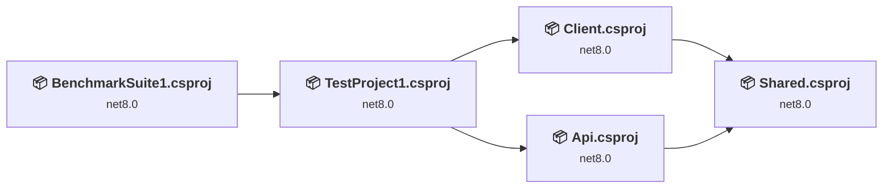
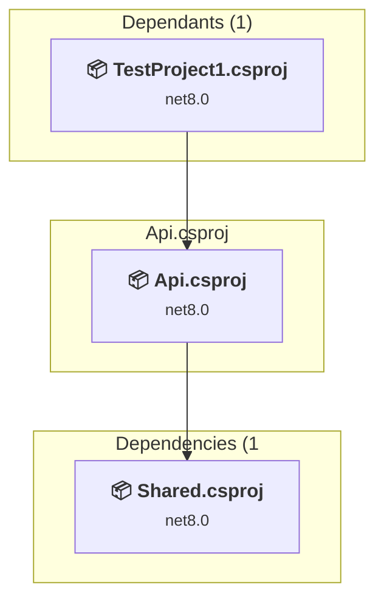
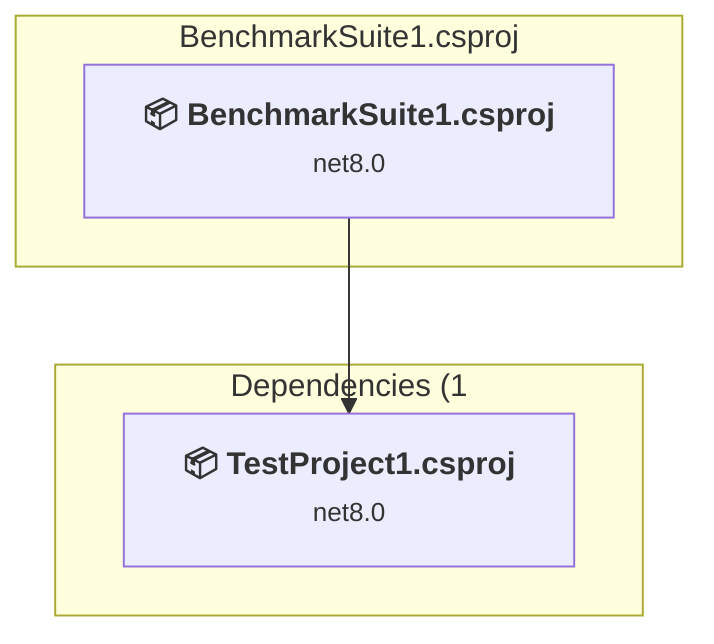
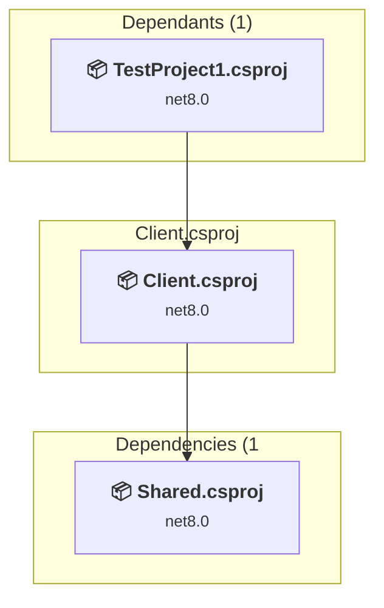
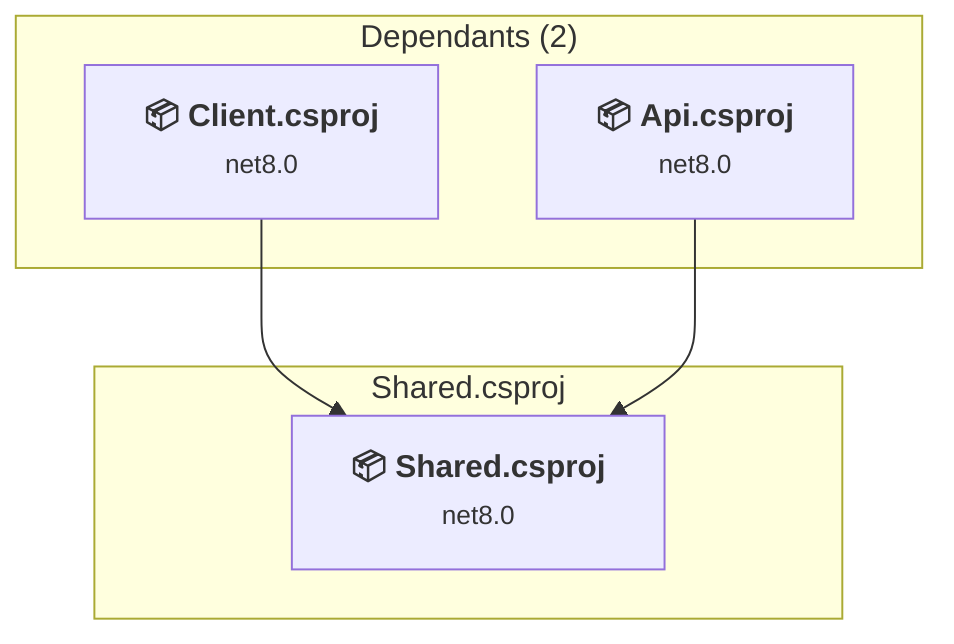
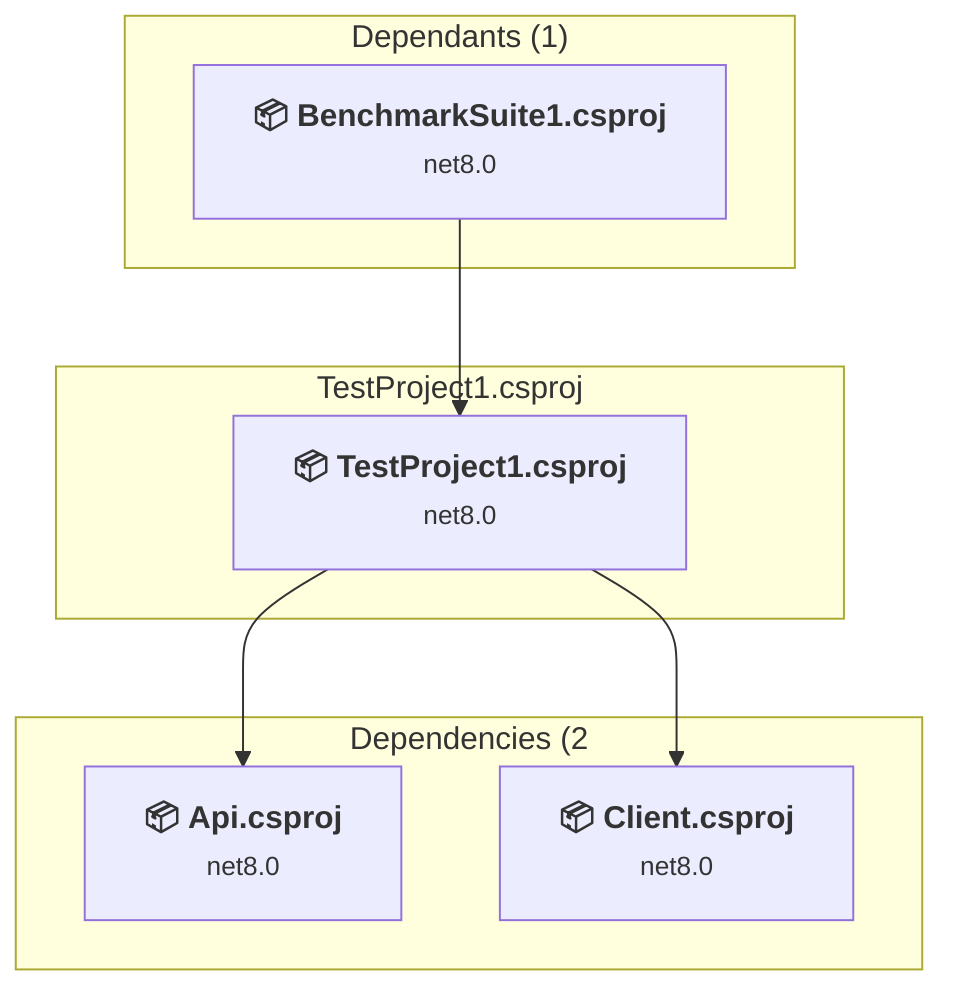

# Projects and dependencies analysis

This document provides a comprehensive overview of the projects and their dependencies in the context of upgrading to .NETCoreApp,Version=v10.0.

## Table of Contents

- [Executive Summary](#executive-Summary)
  - [Highlevel Metrics](#highlevel-metrics)
  - [Projects Compatibility](#projects-compatibility)
  - [Package Compatibility](#package-compatibility)
  - [API Compatibility](#api-compatibility)
  - [Binding Redirect Configuration](#binding-redirect-configuration)
- [Aggregate NuGet packages details](#aggregate-nuget-packages-details)
- [Top API Migration Challenges](#top-api-migration-challenges)
  - [Technologies and Features](#technologies-and-features)
  - [Most Frequent API Issues](#most-frequent-api-issues)
- [Projects Relationship Graph](#projects-relationship-graph)
- [Project Details](#project-details)

  - [Api\Api.csproj](#apiapicsproj)
  - [BenchmarkSuite1\BenchmarkSuite1.csproj](#benchmarksuite1benchmarksuite1csproj)
  - [Client\Client.csproj](#clientclientcsproj)
  - [Shared\Shared.csproj](#sharedsharedcsproj)
  - [TestProject1\TestProject1.csproj](#testproject1testproject1csproj)

## Executive Summary

### Highlevel Metrics

| Metric | Count | Status |
| :--- | :---: | :--- |
| Total Projects | 5 | All require upgrade |
| Total NuGet Packages | 144 | 14 need upgrade |
| Total Code Files | 105 |  |
| Total Code Files with Incidents | 39 |  |
| Total Lines of Code | 45661 |  |
| Total Number of Issues | 198 |  |
| Estimated LOC to modify | 177+ | at least 0.4% of codebase |

### Projects Compatibility

| Project | Target Framework | Difficulty | Package Issues | API Issues | Binding Issues | Est. LOC Impact | Description |
| :--- | :---: | :---: | :---: | :---: | :---: | :---: | :--- |
| [Api\Api.csproj](#apiapicsproj) | net8.0 | 🔴 High | 5 | 11 | 0 | 11+ | AzureFunctions, Sdk Style = True |
| [BenchmarkSuite1\BenchmarkSuite1.csproj](#benchmarksuite1benchmarksuite1csproj) | net8.0 | 🟢 Low | 0 | 0 | 0 |  | DotNetCoreApp, Sdk Style = True |
| [Client\Client.csproj](#clientclientcsproj) | net8.0 | 🟢 Low | 6 | 109 | 0 | 109+ | AspNetCore, Sdk Style = True |
| [Shared\Shared.csproj](#sharedsharedcsproj) | net8.0 | 🟢 Low | 2 | 5 | 0 | 5+ | ClassLibrary, Sdk Style = True |
| [TestProject1\TestProject1.csproj](#testproject1testproject1csproj) | net8.0 | 🟢 Low | 2 | 52 | 0 | 52+ | DotNetCoreApp, Sdk Style = True |

### Package Compatibility

| Status | Count | Percentage |
| :--- | :---: | :---: |
| ✅ Compatible | 130 | 90.3% |
| ⚠️ Incompatible | 2 | 1.4% |
| 🔄 Upgrade Recommended | 12 | 8.3% |
| ***Total NuGet Packages*** | ***144*** | ***100%*** |

### API Compatibility

| Category | Count | Impact |
| :--- | :---: | :--- |
| 🔴 Binary Incompatible | 3 | High - Require code changes |
| 🟡 Source Incompatible | 36 | Medium - Needs re-compilation and potential conflicting API error fixing |
| 🔵 Behavioral change | 138 | Low - Behavioral changes that may require testing at runtime |
| ✅ Compatible | 74839 |  |
| ***Total APIs Analyzed*** | ***75016*** |  |

## Aggregate NuGet packages details

| Package | Current Version | Suggested Version | Projects | Description |
| :--- | :---: | :---: | :--- | :--- |
| Azure.Core | 1.36.0 |  | [Api.csproj](#apiapicsproj) [BenchmarkSuite1.csproj](#benchmarksuite1benchmarksuite1csproj) [TestProject1.csproj](#testproject1testproject1csproj) | ✅Compatible |
| Azure.Storage.Blobs | 12.19.1 |  | [Api.csproj](#apiapicsproj) [BenchmarkSuite1.csproj](#benchmarksuite1benchmarksuite1csproj) [TestProject1.csproj](#testproject1testproject1csproj) | ✅Compatible |
| Azure.Storage.Common | 12.18.1 |  | [Api.csproj](#apiapicsproj) [BenchmarkSuite1.csproj](#benchmarksuite1benchmarksuite1csproj) [TestProject1.csproj](#testproject1testproject1csproj) | ✅Compatible |
| BenchmarkDotNet | 0.15.2 |  | [BenchmarkSuite1.csproj](#benchmarksuite1benchmarksuite1csproj) | ✅Compatible |
| BenchmarkDotNet.Annotations | 0.15.2 |  | [BenchmarkSuite1.csproj](#benchmarksuite1benchmarksuite1csproj) | ✅Compatible |
| Castle.Core | 5.1.1 |  | [BenchmarkSuite1.csproj](#benchmarksuite1benchmarksuite1csproj) [TestProject1.csproj](#testproject1testproject1csproj) | ✅Compatible |
| CommandLineParser | 2.9.1 |  | [BenchmarkSuite1.csproj](#benchmarksuite1benchmarksuite1csproj) | ✅Compatible |
| coverlet.collector | 6.0.0 |  | [BenchmarkSuite1.csproj](#benchmarksuite1benchmarksuite1csproj) [TestProject1.csproj](#testproject1testproject1csproj) | ✅Compatible |
| DictionaryLib_Calvin_Hsia | 1.0.9 |  | [BenchmarkSuite1.csproj](#benchmarksuite1benchmarksuite1csproj) [Client.csproj](#clientclientcsproj) [TestProject1.csproj](#testproject1testproject1csproj) | ✅Compatible |
| Gee.External.Capstone | 2.3.0 |  | [BenchmarkSuite1.csproj](#benchmarksuite1benchmarksuite1csproj) | ✅Compatible |
| Google.Protobuf | 3.23.3 |  | [Api.csproj](#apiapicsproj) [BenchmarkSuite1.csproj](#benchmarksuite1benchmarksuite1csproj) [TestProject1.csproj](#testproject1testproject1csproj) | ✅Compatible |
| Grpc.Core.Api | 2.55.0 |  | [Api.csproj](#apiapicsproj) [BenchmarkSuite1.csproj](#benchmarksuite1benchmarksuite1csproj) [TestProject1.csproj](#testproject1testproject1csproj) | ✅Compatible |
| Grpc.Net.Client | 2.55.0 |  | [Api.csproj](#apiapicsproj) [BenchmarkSuite1.csproj](#benchmarksuite1benchmarksuite1csproj) [TestProject1.csproj](#testproject1testproject1csproj) | ✅Compatible |
| Grpc.Net.ClientFactory | 2.55.0 |  | [Api.csproj](#apiapicsproj) [BenchmarkSuite1.csproj](#benchmarksuite1benchmarksuite1csproj) [TestProject1.csproj](#testproject1testproject1csproj) | ✅Compatible |
| Grpc.Net.Common | 2.55.0 |  | [Api.csproj](#apiapicsproj) [BenchmarkSuite1.csproj](#benchmarksuite1benchmarksuite1csproj) [TestProject1.csproj](#testproject1testproject1csproj) | ✅Compatible |
| Iced | 1.21.0 |  | [BenchmarkSuite1.csproj](#benchmarksuite1benchmarksuite1csproj) | ✅Compatible |
| MetadataExtractor | 2.9.3 |  | [BenchmarkSuite1.csproj](#benchmarksuite1benchmarksuite1csproj) [TestProject1.csproj](#testproject1testproject1csproj) | ✅Compatible |
| Microsoft.AspNetCore.Authorization | 8.0.0 |  | [BenchmarkSuite1.csproj](#benchmarksuite1benchmarksuite1csproj) [Client.csproj](#clientclientcsproj) [TestProject1.csproj](#testproject1testproject1csproj) | ✅Compatible |
| Microsoft.AspNetCore.Components | 8.0.0 |  | [BenchmarkSuite1.csproj](#benchmarksuite1benchmarksuite1csproj) [Client.csproj](#clientclientcsproj) [TestProject1.csproj](#testproject1testproject1csproj) | ✅Compatible |
| Microsoft.AspNetCore.Components.Analyzers | 8.0.0 |  | [BenchmarkSuite1.csproj](#benchmarksuite1benchmarksuite1csproj) [Client.csproj](#clientclientcsproj) [TestProject1.csproj](#testproject1testproject1csproj) | ✅Compatible |
| Microsoft.AspNetCore.Components.Authorization | 8.0.0 | 10.0.13 | [BenchmarkSuite1.csproj](#benchmarksuite1benchmarksuite1csproj) [Client.csproj](#clientclientcsproj) [TestProject1.csproj](#testproject1testproject1csproj) | NuGet package upgrade is recommended |
| Microsoft.AspNetCore.Components.Forms | 8.0.0 |  | [BenchmarkSuite1.csproj](#benchmarksuite1benchmarksuite1csproj) [Client.csproj](#clientclientcsproj) [TestProject1.csproj](#testproject1testproject1csproj) | ✅Compatible |
| Microsoft.AspNetCore.Components.Web | 8.0.0 |  | [BenchmarkSuite1.csproj](#benchmarksuite1benchmarksuite1csproj) [Client.csproj](#clientclientcsproj) [TestProject1.csproj](#testproject1testproject1csproj) | ✅Compatible |
| Microsoft.AspNetCore.Components.WebAssembly | 8.0.0 | 10.0.13 | [BenchmarkSuite1.csproj](#benchmarksuite1benchmarksuite1csproj) [Client.csproj](#clientclientcsproj) [TestProject1.csproj](#testproject1testproject1csproj) | NuGet package upgrade is recommended |
| Microsoft.AspNetCore.Components.WebAssembly.Authentication | 8.0.0 |  | [BenchmarkSuite1.csproj](#benchmarksuite1benchmarksuite1csproj) [Client.csproj](#clientclientcsproj) [TestProject1.csproj](#testproject1testproject1csproj) | ✅Compatible |
| Microsoft.AspNetCore.Components.WebAssembly.DevServer | 8.0.0 | 10.0.13 | [BenchmarkSuite1.csproj](#benchmarksuite1benchmarksuite1csproj) [Client.csproj](#clientclientcsproj) [TestProject1.csproj](#testproject1testproject1csproj) | NuGet package upgrade is recommended |
| Microsoft.AspNetCore.Metadata | 8.0.0 |  | [BenchmarkSuite1.csproj](#benchmarksuite1benchmarksuite1csproj) [Client.csproj](#clientclientcsproj) [TestProject1.csproj](#testproject1testproject1csproj) | ✅Compatible |
| Microsoft.Authentication.WebAssembly.Msal | 8.0.0 | 10.0.13 | [BenchmarkSuite1.csproj](#benchmarksuite1benchmarksuite1csproj) [Client.csproj](#clientclientcsproj) [TestProject1.csproj](#testproject1testproject1csproj) | NuGet package upgrade is recommended |
| Microsoft.Azure.Functions.Worker | 1.20.0 | 2.52.0 | [Api.csproj](#apiapicsproj) [BenchmarkSuite1.csproj](#benchmarksuite1benchmarksuite1csproj) [TestProject1.csproj](#testproject1testproject1csproj) | NuGet package upgrade is recommended |
| Microsoft.Azure.Functions.Worker.Core | 1.16.0 |  | [Api.csproj](#apiapicsproj) [BenchmarkSuite1.csproj](#benchmarksuite1benchmarksuite1csproj) [TestProject1.csproj](#testproject1testproject1csproj) | ✅Compatible |
| Microsoft.Azure.Functions.Worker.Extensions.Abstractions | 1.3.0 |  | [Api.csproj](#apiapicsproj) [BenchmarkSuite1.csproj](#benchmarksuite1benchmarksuite1csproj) [TestProject1.csproj](#testproject1testproject1csproj) | ✅Compatible |
| Microsoft.Azure.Functions.Worker.Extensions.Http | 3.1.0 | 3.3.0 | [Api.csproj](#apiapicsproj) [BenchmarkSuite1.csproj](#benchmarksuite1benchmarksuite1csproj) [TestProject1.csproj](#testproject1testproject1csproj) | NuGet package upgrade is recommended |
| Microsoft.Azure.Functions.Worker.Grpc | 1.15.0 |  | [Api.csproj](#apiapicsproj) [BenchmarkSuite1.csproj](#benchmarksuite1benchmarksuite1csproj) [TestProject1.csproj](#testproject1testproject1csproj) | ✅Compatible |
| Microsoft.Azure.Functions.Worker.Sdk | 1.17.0 | 2.1.0 | [Api.csproj](#apiapicsproj) [BenchmarkSuite1.csproj](#benchmarksuite1benchmarksuite1csproj) [TestProject1.csproj](#testproject1testproject1csproj) | NuGet package upgrade is recommended |
| Microsoft.Azure.Functions.Worker.Sdk.Analyzers | 1.2.1 |  | [Api.csproj](#apiapicsproj) [BenchmarkSuite1.csproj](#benchmarksuite1benchmarksuite1csproj) [TestProject1.csproj](#testproject1testproject1csproj) | ✅Compatible |
| Microsoft.Azure.Functions.Worker.Sdk.Generators | 1.2.0 |  | [Api.csproj](#apiapicsproj) [BenchmarkSuite1.csproj](#benchmarksuite1benchmarksuite1csproj) [TestProject1.csproj](#testproject1testproject1csproj) | ✅Compatible |
| Microsoft.Bcl.AsyncInterfaces | 1.1.1 |  | [Api.csproj](#apiapicsproj) | ✅Compatible |
| Microsoft.Bcl.AsyncInterfaces | 6.0.0 |  | [BenchmarkSuite1.csproj](#benchmarksuite1benchmarksuite1csproj) [TestProject1.csproj](#testproject1testproject1csproj) | ✅Compatible |
| Microsoft.CodeAnalysis.Analyzers | 3.11.0 |  | [BenchmarkSuite1.csproj](#benchmarksuite1benchmarksuite1csproj) | ✅Compatible |
| Microsoft.CodeAnalysis.Common | 4.14.0 |  | [BenchmarkSuite1.csproj](#benchmarksuite1benchmarksuite1csproj) | ✅Compatible |
| Microsoft.CodeAnalysis.CSharp | 4.14.0 |  | [BenchmarkSuite1.csproj](#benchmarksuite1benchmarksuite1csproj) | ✅Compatible |
| Microsoft.CodeCoverage | 17.8.0 |  | [BenchmarkSuite1.csproj](#benchmarksuite1benchmarksuite1csproj) [TestProject1.csproj](#testproject1testproject1csproj) | ✅Compatible |
| Microsoft.Data.Sqlite.Core | 8.0.0 |  | [Api.csproj](#apiapicsproj) [BenchmarkSuite1.csproj](#benchmarksuite1benchmarksuite1csproj) [TestProject1.csproj](#testproject1testproject1csproj) | ✅Compatible |
| Microsoft.Diagnostics.NETCore.Client | 0.2.510501 |  | [BenchmarkSuite1.csproj](#benchmarksuite1benchmarksuite1csproj) | ✅Compatible |
| Microsoft.Diagnostics.Runtime | 3.1.512801 |  | [BenchmarkSuite1.csproj](#benchmarksuite1benchmarksuite1csproj) | ✅Compatible |
| Microsoft.Diagnostics.Tracing.TraceEvent | 3.1.21 |  | [BenchmarkSuite1.csproj](#benchmarksuite1benchmarksuite1csproj) | ✅Compatible |
| Microsoft.DotNet.PlatformAbstractions | 3.1.6 |  | [BenchmarkSuite1.csproj](#benchmarksuite1benchmarksuite1csproj) | ✅Compatible |
| Microsoft.EntityFrameworkCore | 8.0.0 | 10.0.13 | [Api.csproj](#apiapicsproj) [BenchmarkSuite1.csproj](#benchmarksuite1benchmarksuite1csproj) [TestProject1.csproj](#testproject1testproject1csproj) | NuGet package upgrade is recommended |
| Microsoft.EntityFrameworkCore.Abstractions | 8.0.0 |  | [Api.csproj](#apiapicsproj) [BenchmarkSuite1.csproj](#benchmarksuite1benchmarksuite1csproj) [TestProject1.csproj](#testproject1testproject1csproj) | ✅Compatible |
| Microsoft.EntityFrameworkCore.Analyzers | 8.0.0 |  | [Api.csproj](#apiapicsproj) [BenchmarkSuite1.csproj](#benchmarksuite1benchmarksuite1csproj) [TestProject1.csproj](#testproject1testproject1csproj) | ✅Compatible |
| Microsoft.EntityFrameworkCore.Relational | 8.0.0 |  | [Api.csproj](#apiapicsproj) [BenchmarkSuite1.csproj](#benchmarksuite1benchmarksuite1csproj) [TestProject1.csproj](#testproject1testproject1csproj) | ✅Compatible |
| Microsoft.EntityFrameworkCore.Sqlite | 8.0.0 | 10.0.13 | [Api.csproj](#apiapicsproj) [BenchmarkSuite1.csproj](#benchmarksuite1benchmarksuite1csproj) [TestProject1.csproj](#testproject1testproject1csproj) | NuGet package upgrade is recommended |
| Microsoft.EntityFrameworkCore.Sqlite.Core | 8.0.0 |  | [Api.csproj](#apiapicsproj) [BenchmarkSuite1.csproj](#benchmarksuite1benchmarksuite1csproj) [TestProject1.csproj](#testproject1testproject1csproj) | ✅Compatible |
| Microsoft.Extensions.Caching.Abstractions | 8.0.0 |  | [Api.csproj](#apiapicsproj) [BenchmarkSuite1.csproj](#benchmarksuite1benchmarksuite1csproj) [TestProject1.csproj](#testproject1testproject1csproj) | ✅Compatible |
| Microsoft.Extensions.Caching.Memory | 8.0.0 |  | [Api.csproj](#apiapicsproj) [BenchmarkSuite1.csproj](#benchmarksuite1benchmarksuite1csproj) [TestProject1.csproj](#testproject1testproject1csproj) | ✅Compatible |
| Microsoft.Extensions.Configuration | 5.0.0 |  | [Api.csproj](#apiapicsproj) | ✅Compatible |
| Microsoft.Extensions.Configuration | 8.0.0 |  | [BenchmarkSuite1.csproj](#benchmarksuite1benchmarksuite1csproj) [Client.csproj](#clientclientcsproj) [TestProject1.csproj](#testproject1testproject1csproj) | ✅Compatible |
| Microsoft.Extensions.Configuration.Abstractions | 8.0.0 |  | [Api.csproj](#apiapicsproj) [BenchmarkSuite1.csproj](#benchmarksuite1benchmarksuite1csproj) [Client.csproj](#clientclientcsproj) [TestProject1.csproj](#testproject1testproject1csproj) | ✅Compatible |
| Microsoft.Extensions.Configuration.Binder | 5.0.0 |  | [Api.csproj](#apiapicsproj) | ✅Compatible |
| Microsoft.Extensions.Configuration.Binder | 8.0.0 |  | [BenchmarkSuite1.csproj](#benchmarksuite1benchmarksuite1csproj) [Client.csproj](#clientclientcsproj) [TestProject1.csproj](#testproject1testproject1csproj) | ✅Compatible |
| Microsoft.Extensions.Configuration.CommandLine | 5.0.0 |  | [Api.csproj](#apiapicsproj) [BenchmarkSuite1.csproj](#benchmarksuite1benchmarksuite1csproj) [TestProject1.csproj](#testproject1testproject1csproj) | ✅Compatible |
| Microsoft.Extensions.Configuration.EnvironmentVariables | 5.0.0 |  | [Api.csproj](#apiapicsproj) [BenchmarkSuite1.csproj](#benchmarksuite1benchmarksuite1csproj) [TestProject1.csproj](#testproject1testproject1csproj) | ✅Compatible |
| Microsoft.Extensions.Configuration.FileExtensions | 5.0.0 |  | [Api.csproj](#apiapicsproj) | ✅Compatible |
| Microsoft.Extensions.Configuration.FileExtensions | 8.0.0 |  | [BenchmarkSuite1.csproj](#benchmarksuite1benchmarksuite1csproj) [Client.csproj](#clientclientcsproj) [TestProject1.csproj](#testproject1testproject1csproj) | ✅Compatible |
| Microsoft.Extensions.Configuration.Json | 5.0.0 |  | [Api.csproj](#apiapicsproj) | ✅Compatible |
| Microsoft.Extensions.Configuration.Json | 8.0.0 |  | [BenchmarkSuite1.csproj](#benchmarksuite1benchmarksuite1csproj) [Client.csproj](#clientclientcsproj) [TestProject1.csproj](#testproject1testproject1csproj) | ✅Compatible |
| Microsoft.Extensions.Configuration.UserSecrets | 5.0.0 |  | [Api.csproj](#apiapicsproj) [BenchmarkSuite1.csproj](#benchmarksuite1benchmarksuite1csproj) [TestProject1.csproj](#testproject1testproject1csproj) | ✅Compatible |
| Microsoft.Extensions.DependencyInjection | 8.0.0 |  | [Api.csproj](#apiapicsproj) [BenchmarkSuite1.csproj](#benchmarksuite1benchmarksuite1csproj) [Client.csproj](#clientclientcsproj) [TestProject1.csproj](#testproject1testproject1csproj) | ✅Compatible |
| Microsoft.Extensions.DependencyInjection.Abstractions | 8.0.0 |  | [Api.csproj](#apiapicsproj) [BenchmarkSuite1.csproj](#benchmarksuite1benchmarksuite1csproj) [Client.csproj](#clientclientcsproj) [TestProject1.csproj](#testproject1testproject1csproj) | ✅Compatible |
| Microsoft.Extensions.DependencyModel | 8.0.0 |  | [Api.csproj](#apiapicsproj) [BenchmarkSuite1.csproj](#benchmarksuite1benchmarksuite1csproj) [TestProject1.csproj](#testproject1testproject1csproj) | ✅Compatible |
| Microsoft.Extensions.Diagnostics | 8.0.0 |  | [BenchmarkSuite1.csproj](#benchmarksuite1benchmarksuite1csproj) [Client.csproj](#clientclientcsproj) [TestProject1.csproj](#testproject1testproject1csproj) | ✅Compatible |
| Microsoft.Extensions.Diagnostics.Abstractions | 8.0.0 |  | [BenchmarkSuite1.csproj](#benchmarksuite1benchmarksuite1csproj) [Client.csproj](#clientclientcsproj) [TestProject1.csproj](#testproject1testproject1csproj) | ✅Compatible |
| Microsoft.Extensions.FileProviders.Abstractions | 5.0.0 |  | [Api.csproj](#apiapicsproj) | ✅Compatible |
| Microsoft.Extensions.FileProviders.Abstractions | 8.0.0 |  | [BenchmarkSuite1.csproj](#benchmarksuite1benchmarksuite1csproj) [Client.csproj](#clientclientcsproj) [TestProject1.csproj](#testproject1testproject1csproj) | ✅Compatible |
| Microsoft.Extensions.FileProviders.Physical | 5.0.0 |  | [Api.csproj](#apiapicsproj) | ✅Compatible |
| Microsoft.Extensions.FileProviders.Physical | 8.0.0 |  | [BenchmarkSuite1.csproj](#benchmarksuite1benchmarksuite1csproj) [Client.csproj](#clientclientcsproj) [TestProject1.csproj](#testproject1testproject1csproj) | ✅Compatible |
| Microsoft.Extensions.FileSystemGlobbing | 5.0.0 |  | [Api.csproj](#apiapicsproj) | ✅Compatible |
| Microsoft.Extensions.FileSystemGlobbing | 8.0.0 |  | [BenchmarkSuite1.csproj](#benchmarksuite1benchmarksuite1csproj) [Client.csproj](#clientclientcsproj) [TestProject1.csproj](#testproject1testproject1csproj) | ✅Compatible |
| Microsoft.Extensions.Hosting | 5.0.0 |  | [Api.csproj](#apiapicsproj) [BenchmarkSuite1.csproj](#benchmarksuite1benchmarksuite1csproj) [TestProject1.csproj](#testproject1testproject1csproj) | ✅Compatible |
| Microsoft.Extensions.Hosting.Abstractions | 5.0.0 |  | [Api.csproj](#apiapicsproj) [BenchmarkSuite1.csproj](#benchmarksuite1benchmarksuite1csproj) [TestProject1.csproj](#testproject1testproject1csproj) | ✅Compatible |
| Microsoft.Extensions.Http | 3.0.3 |  | [Api.csproj](#apiapicsproj) | ✅Compatible |
| Microsoft.Extensions.Http | 8.0.0 | 10.0.13 | [BenchmarkSuite1.csproj](#benchmarksuite1benchmarksuite1csproj) [Client.csproj](#clientclientcsproj) [TestProject1.csproj](#testproject1testproject1csproj) | NuGet package upgrade is recommended |
| Microsoft.Extensions.Logging | 8.0.0 |  | [Api.csproj](#apiapicsproj) [BenchmarkSuite1.csproj](#benchmarksuite1benchmarksuite1csproj) [Client.csproj](#clientclientcsproj) [TestProject1.csproj](#testproject1testproject1csproj) | ✅Compatible |
| Microsoft.Extensions.Logging.Abstractions | 8.0.0 |  | [Api.csproj](#apiapicsproj) [BenchmarkSuite1.csproj](#benchmarksuite1benchmarksuite1csproj) [Client.csproj](#clientclientcsproj) [TestProject1.csproj](#testproject1testproject1csproj) | ✅Compatible |
| Microsoft.Extensions.Logging.Configuration | 5.0.0 |  | [Api.csproj](#apiapicsproj) [BenchmarkSuite1.csproj](#benchmarksuite1benchmarksuite1csproj) [TestProject1.csproj](#testproject1testproject1csproj) | ✅Compatible |
| Microsoft.Extensions.Logging.Console | 5.0.0 |  | [Api.csproj](#apiapicsproj) [BenchmarkSuite1.csproj](#benchmarksuite1benchmarksuite1csproj) [TestProject1.csproj](#testproject1testproject1csproj) | ✅Compatible |
| Microsoft.Extensions.Logging.Debug | 5.0.0 |  | [Api.csproj](#apiapicsproj) [BenchmarkSuite1.csproj](#benchmarksuite1benchmarksuite1csproj) [TestProject1.csproj](#testproject1testproject1csproj) | ✅Compatible |
| Microsoft.Extensions.Logging.EventLog | 5.0.0 |  | [Api.csproj](#apiapicsproj) [BenchmarkSuite1.csproj](#benchmarksuite1benchmarksuite1csproj) [TestProject1.csproj](#testproject1testproject1csproj) | ✅Compatible |
| Microsoft.Extensions.Logging.EventSource | 5.0.0 |  | [Api.csproj](#apiapicsproj) [BenchmarkSuite1.csproj](#benchmarksuite1benchmarksuite1csproj) [TestProject1.csproj](#testproject1testproject1csproj) | ✅Compatible |
| Microsoft.Extensions.Options | 8.0.0 |  | [Api.csproj](#apiapicsproj) [BenchmarkSuite1.csproj](#benchmarksuite1benchmarksuite1csproj) [Client.csproj](#clientclientcsproj) [TestProject1.csproj](#testproject1testproject1csproj) | ✅Compatible |
| Microsoft.Extensions.Options.ConfigurationExtensions | 5.0.0 |  | [Api.csproj](#apiapicsproj) | ✅Compatible |
| Microsoft.Extensions.Options.ConfigurationExtensions | 8.0.0 |  | [BenchmarkSuite1.csproj](#benchmarksuite1benchmarksuite1csproj) [Client.csproj](#clientclientcsproj) [TestProject1.csproj](#testproject1testproject1csproj) | ✅Compatible |
| Microsoft.Extensions.Primitives | 8.0.0 |  | [Api.csproj](#apiapicsproj) [BenchmarkSuite1.csproj](#benchmarksuite1benchmarksuite1csproj) [Client.csproj](#clientclientcsproj) [TestProject1.csproj](#testproject1testproject1csproj) | ✅Compatible |
| Microsoft.IdentityModel.Abstractions | 8.18.0 |  | [Api.csproj](#apiapicsproj) [BenchmarkSuite1.csproj](#benchmarksuite1benchmarksuite1csproj) [TestProject1.csproj](#testproject1testproject1csproj) | ✅Compatible |
| Microsoft.IdentityModel.JsonWebTokens | 8.18.0 |  | [Api.csproj](#apiapicsproj) [BenchmarkSuite1.csproj](#benchmarksuite1benchmarksuite1csproj) [TestProject1.csproj](#testproject1testproject1csproj) | ✅Compatible |
| Microsoft.IdentityModel.Logging | 8.18.0 |  | [Api.csproj](#apiapicsproj) [BenchmarkSuite1.csproj](#benchmarksuite1benchmarksuite1csproj) [TestProject1.csproj](#testproject1testproject1csproj) | ✅Compatible |
| Microsoft.IdentityModel.Protocols | 8.18.0 |  | [Api.csproj](#apiapicsproj) [BenchmarkSuite1.csproj](#benchmarksuite1benchmarksuite1csproj) [TestProject1.csproj](#testproject1testproject1csproj) | ✅Compatible |
| Microsoft.IdentityModel.Protocols.OpenIdConnect | 8.18.0 |  | [Api.csproj](#apiapicsproj) [BenchmarkSuite1.csproj](#benchmarksuite1benchmarksuite1csproj) [TestProject1.csproj](#testproject1testproject1csproj) | ✅Compatible |
| Microsoft.IdentityModel.Tokens | 8.18.0 |  | [Api.csproj](#apiapicsproj) [BenchmarkSuite1.csproj](#benchmarksuite1benchmarksuite1csproj) [TestProject1.csproj](#testproject1testproject1csproj) | ✅Compatible |
| Microsoft.JSInterop | 8.0.0 |  | [BenchmarkSuite1.csproj](#benchmarksuite1benchmarksuite1csproj) [Client.csproj](#clientclientcsproj) [TestProject1.csproj](#testproject1testproject1csproj) | ✅Compatible |
| Microsoft.JSInterop.WebAssembly | 8.0.0 | 10.0.13 | [BenchmarkSuite1.csproj](#benchmarksuite1benchmarksuite1csproj) [Client.csproj](#clientclientcsproj) [TestProject1.csproj](#testproject1testproject1csproj) | NuGet package upgrade is recommended |
| Microsoft.NET.Sdk.WebAssembly.Pack | 10.0.11 |  | [Client.csproj](#clientclientcsproj) | ✅Compatible |
| Microsoft.NET.Test.Sdk | 17.8.0 |  | [BenchmarkSuite1.csproj](#benchmarksuite1benchmarksuite1csproj) [TestProject1.csproj](#testproject1testproject1csproj) | ✅Compatible |
| Microsoft.NETCore.Platforms | 5.0.0 |  | [Api.csproj](#apiapicsproj) [BenchmarkSuite1.csproj](#benchmarksuite1benchmarksuite1csproj) | ✅Compatible |
| Microsoft.Playwright | 1.41.0 |  | [BenchmarkSuite1.csproj](#benchmarksuite1benchmarksuite1csproj) [TestProject1.csproj](#testproject1testproject1csproj) | ✅Compatible |
| Microsoft.TestPlatform.ObjectModel | 17.8.0 |  | [BenchmarkSuite1.csproj](#benchmarksuite1benchmarksuite1csproj) [TestProject1.csproj](#testproject1testproject1csproj) | ✅Compatible |
| Microsoft.TestPlatform.TestHost | 17.8.0 |  | [BenchmarkSuite1.csproj](#benchmarksuite1benchmarksuite1csproj) [TestProject1.csproj](#testproject1testproject1csproj) | ✅Compatible |
| Microsoft.VisualStudio.DiagnosticsHub.BenchmarkDotNetDiagnosers | 18.3.36812.1 |  | [BenchmarkSuite1.csproj](#benchmarksuite1benchmarksuite1csproj) | ✅Compatible |
| Microsoft.Win32.Registry | 5.0.0 |  | [Api.csproj](#apiapicsproj) [BenchmarkSuite1.csproj](#benchmarksuite1benchmarksuite1csproj) | ✅Compatible |
| Moq | 4.20.72 |  | [BenchmarkSuite1.csproj](#benchmarksuite1benchmarksuite1csproj) [TestProject1.csproj](#testproject1testproject1csproj) | ✅Compatible |
| MSTest.TestAdapter | 3.1.1 |  | [BenchmarkSuite1.csproj](#benchmarksuite1benchmarksuite1csproj) [TestProject1.csproj](#testproject1testproject1csproj) | ⚠️NuGet package is deprecated |
| MSTest.TestFramework | 3.1.1 |  | [BenchmarkSuite1.csproj](#benchmarksuite1benchmarksuite1csproj) [TestProject1.csproj](#testproject1testproject1csproj) | ⚠️NuGet package is deprecated |
| Newtonsoft.Json | 13.0.1 |  | [BenchmarkSuite1.csproj](#benchmarksuite1benchmarksuite1csproj) [TestProject1.csproj](#testproject1testproject1csproj) | ✅Compatible |
| NuGet.Frameworks | 6.5.0 |  | [BenchmarkSuite1.csproj](#benchmarksuite1benchmarksuite1csproj) [TestProject1.csproj](#testproject1testproject1csproj) | ✅Compatible |
| Perfolizer | 0.5.3 |  | [BenchmarkSuite1.csproj](#benchmarksuite1benchmarksuite1csproj) | ✅Compatible |
| SQLitePCLRaw.bundle_e_sqlite3 | 2.1.6 |  | [Api.csproj](#apiapicsproj) [BenchmarkSuite1.csproj](#benchmarksuite1benchmarksuite1csproj) [TestProject1.csproj](#testproject1testproject1csproj) | ✅Compatible |
| SQLitePCLRaw.core | 2.1.6 |  | [Api.csproj](#apiapicsproj) [BenchmarkSuite1.csproj](#benchmarksuite1benchmarksuite1csproj) [TestProject1.csproj](#testproject1testproject1csproj) | ✅Compatible |
| SQLitePCLRaw.lib.e_sqlite3 | 2.1.6 |  | [Api.csproj](#apiapicsproj) [BenchmarkSuite1.csproj](#benchmarksuite1benchmarksuite1csproj) [TestProject1.csproj](#testproject1testproject1csproj) | ✅Compatible |
| SQLitePCLRaw.provider.e_sqlite3 | 2.1.6 |  | [Api.csproj](#apiapicsproj) [BenchmarkSuite1.csproj](#benchmarksuite1benchmarksuite1csproj) [TestProject1.csproj](#testproject1testproject1csproj) | ✅Compatible |
| System.CodeDom | 9.0.5 |  | [BenchmarkSuite1.csproj](#benchmarksuite1benchmarksuite1csproj) | ✅Compatible |
| System.Collections.Immutable | 5.0.0 |  | [Api.csproj](#apiapicsproj) [TestProject1.csproj](#testproject1testproject1csproj) | ✅Compatible |
| System.Collections.Immutable | 9.0.0 |  | [BenchmarkSuite1.csproj](#benchmarksuite1benchmarksuite1csproj) | ✅Compatible |
| System.ComponentModel.Annotations | 5.0.0 |  | [Api.csproj](#apiapicsproj) [BenchmarkSuite1.csproj](#benchmarksuite1benchmarksuite1csproj) [Client.csproj](#clientclientcsproj) [Shared.csproj](#sharedsharedcsproj) [TestProject1.csproj](#testproject1testproject1csproj) | NuGet package functionality is included with framework reference |
| System.Diagnostics.DiagnosticSource | 7.0.0 |  | [Api.csproj](#apiapicsproj) | ✅Compatible |
| System.Diagnostics.DiagnosticSource | 8.0.0 |  | [BenchmarkSuite1.csproj](#benchmarksuite1benchmarksuite1csproj) [Client.csproj](#clientclientcsproj) [TestProject1.csproj](#testproject1testproject1csproj) | ✅Compatible |
| System.Diagnostics.EventLog | 5.0.0 |  | [Api.csproj](#apiapicsproj) | ✅Compatible |
| System.Diagnostics.EventLog | 6.0.0 |  | [BenchmarkSuite1.csproj](#benchmarksuite1benchmarksuite1csproj) [TestProject1.csproj](#testproject1testproject1csproj) | ✅Compatible |
| System.IdentityModel.Tokens.Jwt | 8.18.0 |  | [Api.csproj](#apiapicsproj) [BenchmarkSuite1.csproj](#benchmarksuite1benchmarksuite1csproj) [TestProject1.csproj](#testproject1testproject1csproj) | ✅Compatible |
| System.IO.Hashing | 6.0.0 |  | [Api.csproj](#apiapicsproj) [BenchmarkSuite1.csproj](#benchmarksuite1benchmarksuite1csproj) [TestProject1.csproj](#testproject1testproject1csproj) | ✅Compatible |
| System.IO.Pipelines | 9.0.0 |  | [Api.csproj](#apiapicsproj) [BenchmarkSuite1.csproj](#benchmarksuite1benchmarksuite1csproj) [Client.csproj](#clientclientcsproj) [Shared.csproj](#sharedsharedcsproj) [TestProject1.csproj](#testproject1testproject1csproj) | ✅Compatible |
| System.Management | 9.0.5 |  | [BenchmarkSuite1.csproj](#benchmarksuite1benchmarksuite1csproj) | ✅Compatible |
| System.Memory | 4.5.3 |  | [Api.csproj](#apiapicsproj) [BenchmarkSuite1.csproj](#benchmarksuite1benchmarksuite1csproj) [TestProject1.csproj](#testproject1testproject1csproj) | ✅Compatible |
| System.Memory.Data | 1.0.2 |  | [Api.csproj](#apiapicsproj) [BenchmarkSuite1.csproj](#benchmarksuite1benchmarksuite1csproj) [TestProject1.csproj](#testproject1testproject1csproj) | ✅Compatible |
| System.Numerics.Vectors | 4.5.0 |  | [Api.csproj](#apiapicsproj) [BenchmarkSuite1.csproj](#benchmarksuite1benchmarksuite1csproj) [TestProject1.csproj](#testproject1testproject1csproj) | ✅Compatible |
| System.Reflection.Metadata | 1.6.0 |  | [TestProject1.csproj](#testproject1testproject1csproj) | ✅Compatible |
| System.Reflection.Metadata | 9.0.0 |  | [BenchmarkSuite1.csproj](#benchmarksuite1benchmarksuite1csproj) | ✅Compatible |
| System.Reflection.TypeExtensions | 4.7.0 |  | [BenchmarkSuite1.csproj](#benchmarksuite1benchmarksuite1csproj) | ✅Compatible |
| System.Runtime.CompilerServices.Unsafe | 6.0.0 |  | [BenchmarkSuite1.csproj](#benchmarksuite1benchmarksuite1csproj) | ✅Compatible |
| System.Security.AccessControl | 5.0.0 |  | [Api.csproj](#apiapicsproj) [BenchmarkSuite1.csproj](#benchmarksuite1benchmarksuite1csproj) | ✅Compatible |
| System.Security.Principal.Windows | 5.0.0 |  | [Api.csproj](#apiapicsproj) [BenchmarkSuite1.csproj](#benchmarksuite1benchmarksuite1csproj) | ✅Compatible |
| System.Text.Encodings.Web | 9.0.0 |  | [Api.csproj](#apiapicsproj) [BenchmarkSuite1.csproj](#benchmarksuite1benchmarksuite1csproj) [Client.csproj](#clientclientcsproj) [Shared.csproj](#sharedsharedcsproj) [TestProject1.csproj](#testproject1testproject1csproj) | ✅Compatible |
| System.Text.Json | 9.0.0 | 10.0.13 | [Api.csproj](#apiapicsproj) [BenchmarkSuite1.csproj](#benchmarksuite1benchmarksuite1csproj) [Client.csproj](#clientclientcsproj) [Shared.csproj](#sharedsharedcsproj) [TestProject1.csproj](#testproject1testproject1csproj) | NuGet package upgrade is recommended |
| System.Threading.Tasks.Extensions | 4.5.4 |  | [Api.csproj](#apiapicsproj) [BenchmarkSuite1.csproj](#benchmarksuite1benchmarksuite1csproj) [TestProject1.csproj](#testproject1testproject1csproj) | ✅Compatible |
| XmpCore | 6.1.10.1 |  | [BenchmarkSuite1.csproj](#benchmarksuite1benchmarksuite1csproj) [TestProject1.csproj](#testproject1testproject1csproj) | ✅Compatible |

## Top API Migration Challenges

### Technologies and Features

| Technology | Issues | Percentage | Migration Path |
| :--- | :---: | :---: | :--- |
| IdentityModel & Claims-based Security | 3 | 1.7% | Windows Identity Foundation (WIF), SAML, and claims-based authentication APIs that have been replaced by modern identity libraries. WIF was the original identity framework for .NET Framework. Migrate to Microsoft.IdentityModel.* packages (modern identity stack). |

### Most Frequent API Issues

| API | Count | Percentage | Category |
| :--- | :---: | :---: | :--- |
| T:System.Net.Http.HttpContent | 57 | 32.2% | Behavioral Change |
| T:System.Text.Json.JsonDocument | 32 | 18.1% | Behavioral Change |
| T:System.Uri | 24 | 13.6% | Behavioral Change |
| M:System.TimeSpan.FromMinutes(System.Double) | 20 | 11.3% | Source Incompatible |
| M:System.Uri.#ctor(System.String) | 11 | 6.2% | Behavioral Change |
| M:System.TimeSpan.FromSeconds(System.Double) | 8 | 4.5% | Source Incompatible |
| M:System.TimeSpan.FromMilliseconds(System.Double) | 8 | 4.5% | Source Incompatible |
| M:System.Environment.SetEnvironmentVariable(System.String,System.String) | 5 | 2.8% | Behavioral Change |
| M:System.Net.Http.HttpContent.ReadAsStreamAsync | 3 | 1.7% | Behavioral Change |
| M:Microsoft.Extensions.DependencyInjection.HttpClientFactoryServiceCollectionExtensions.AddHttpClient(Microsoft.Extensions.DependencyInjection.IServiceCollection) | 1 | 0.6% | Behavioral Change |
| T:Microsoft.Extensions.Hosting.HostBuilder | 1 | 0.6% | Behavioral Change |
| M:System.IdentityModel.Tokens.Jwt.JwtSecurityTokenHandler.ValidateToken(System.String,Microsoft.IdentityModel.Tokens.TokenValidationParameters,Microsoft.IdentityModel.Tokens.SecurityToken@) | 1 | 0.6% | Binary Incompatible |
| T:System.IdentityModel.Tokens.Jwt.JwtSecurityTokenHandler | 1 | 0.6% | Binary Incompatible |
| M:System.IdentityModel.Tokens.Jwt.JwtSecurityTokenHandler.#ctor | 1 | 0.6% | Binary Incompatible |
| P:System.Uri.AbsolutePath | 1 | 0.6% | Behavioral Change |
| M:Microsoft.Extensions.DependencyInjection.HttpClientFactoryServiceCollectionExtensions.AddHttpClient(Microsoft.Extensions.DependencyInjection.IServiceCollection,System.String,System.Action{System.Net.Http.HttpClient}) | 1 | 0.6% | Behavioral Change |
| P:System.Environment.OSVersion | 1 | 0.6% | Behavioral Change |
| E:System.AppDomain.ProcessExit | 1 | 0.6% | Behavioral Change |

## Projects Relationship Graph

Legend:
📦 SDK-style project
⚙️ Classic project

## Project Details

### Api\Api.csproj

#### Project Info

- **Current Target Framework:** net8.0
- **Proposed Target Framework:** net10.0
- **SDK-style**: True
- **Project Kind:** AzureFunctions
- **Dependencies**: 1
- **Dependants**: 1
- **Number of Files**: 9
- **Number of Files with Incidents**: 5
- **Lines of Code**: 1168
- **Estimated LOC to modify**: 11+ (at least 0.9% of the project)

#### Dependency Graph

Legend:
📦 SDK-style project
⚙️ Classic project

### API Compatibility

| Category | Count | Impact |
| :--- | :---: | :--- |
| 🔴 Binary Incompatible | 3 | High - Require code changes |
| 🟡 Source Incompatible | 1 | Medium - Needs re-compilation and potential conflicting API error fixing |
| 🔵 Behavioral change | 7 | Low - Behavioral changes that may require testing at runtime |
| ✅ Compatible | 1587 |  |
| ***Total APIs Analyzed*** | ***1598*** |  |

#### Project Technologies and Features

| Technology | Issues | Percentage | Migration Path |
| :--- | :---: | :---: | :--- |
| IdentityModel & Claims-based Security | 3 | 27.3% | Windows Identity Foundation (WIF), SAML, and claims-based authentication APIs that have been replaced by modern identity libraries. WIF was the original identity framework for .NET Framework. Migrate to Microsoft.IdentityModel.* packages (modern identity stack). |

### BenchmarkSuite1\BenchmarkSuite1.csproj

#### Project Info

- **Current Target Framework:** net8.0
- **Proposed Target Framework:** net10.0
- **SDK-style**: True
- **Project Kind:** DotNetCoreApp
- **Dependencies**: 1
- **Dependants**: 0
- **Number of Files**: 3
- **Number of Files with Incidents**: 1
- **Lines of Code**: 196
- **Estimated LOC to modify**: 0+ (at least 0.0% of the project)

#### Dependency Graph

Legend:
📦 SDK-style project
⚙️ Classic project

### API Compatibility

| Category | Count | Impact |
| :--- | :---: | :--- |
| 🔴 Binary Incompatible | 0 | High - Require code changes |
| 🟡 Source Incompatible | 0 | Medium - Needs re-compilation and potential conflicting API error fixing |
| 🔵 Behavioral change | 0 | Low - Behavioral changes that may require testing at runtime |
| ✅ Compatible | 318 |  |
| ***Total APIs Analyzed*** | ***318*** |  |

### Client\Client.csproj

#### Project Info

- **Current Target Framework:** net8.0
- **Proposed Target Framework:** net10.0
- **SDK-style**: True
- **Project Kind:** AspNetCore
- **Dependencies**: 1
- **Dependants**: 1
- **Number of Files**: 209
- **Number of Files with Incidents**: 20
- **Lines of Code**: 19292
- **Estimated LOC to modify**: 109+ (at least 0.6% of the project)

#### Dependency Graph

Legend:
📦 SDK-style project
⚙️ Classic project

### API Compatibility

| Category | Count | Impact |
| :--- | :---: | :--- |
| 🔴 Binary Incompatible | 0 | High - Require code changes |
| 🟡 Source Incompatible | 17 | Medium - Needs re-compilation and potential conflicting API error fixing |
| 🔵 Behavioral change | 92 | Low - Behavioral changes that may require testing at runtime |
| ✅ Compatible | 43487 |  |
| ***Total APIs Analyzed*** | ***43596*** |  |

### Shared\Shared.csproj

#### Project Info

- **Current Target Framework:** net8.0
- **Proposed Target Framework:** net10.0
- **SDK-style**: True
- **Project Kind:** ClassLibrary
- **Dependencies**: 0
- **Dependants**: 2
- **Number of Files**: 3
- **Number of Files with Incidents**: 2
- **Lines of Code**: 205
- **Estimated LOC to modify**: 5+ (at least 2.4% of the project)

#### Dependency Graph

Legend:
📦 SDK-style project
⚙️ Classic project

### API Compatibility

| Category | Count | Impact |
| :--- | :---: | :--- |
| 🔴 Binary Incompatible | 0 | High - Require code changes |
| 🟡 Source Incompatible | 1 | Medium - Needs re-compilation and potential conflicting API error fixing |
| 🔵 Behavioral change | 4 | Low - Behavioral changes that may require testing at runtime |
| ✅ Compatible | 319 |  |
| ***Total APIs Analyzed*** | ***324*** |  |

### TestProject1\TestProject1.csproj

#### Project Info

- **Current Target Framework:** net8.0
- **Proposed Target Framework:** net10.0
- **SDK-style**: True
- **Project Kind:** DotNetCoreApp
- **Dependencies**: 2
- **Dependants**: 1
- **Number of Files**: 48
- **Number of Files with Incidents**: 11
- **Lines of Code**: 24800
- **Estimated LOC to modify**: 52+ (at least 0.2% of the project)

#### Dependency Graph

Legend:
📦 SDK-style project
⚙️ Classic project

### API Compatibility

| Category | Count | Impact |
| :--- | :---: | :--- |
| 🔴 Binary Incompatible | 0 | High - Require code changes |
| 🟡 Source Incompatible | 17 | Medium - Needs re-compilation and potential conflicting API error fixing |
| 🔵 Behavioral change | 35 | Low - Behavioral changes that may require testing at runtime |
| ✅ Compatible | 29128 |  |
| ***Total APIs Analyzed*** | ***29180*** |  |

